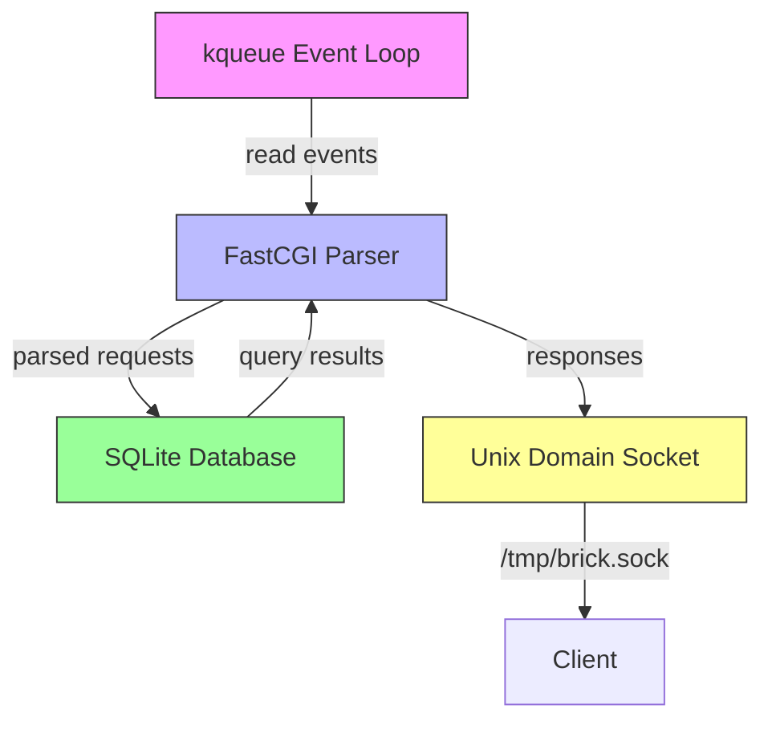

# brick

## The BRICK Architectural Stack

| **B** | Berkeley Software Distribution (BSD) or Darwin as the host operating system |
| **R** | Rust for compiled, memory-safe backend logic |
| **I** | In-process database (SQLite) for direct embedded persistence without network overhead |
| **C** | Common Gateway Interface (CGI), specifically Fast Common Gateway Interface (FastCGI) record protocol |
| **K** | Kernel queue (kqueue) for native event notifications and non-blocking socket multiplexing |

`brick` is a zero-dependency, ultra-minimalist library for building FastCGI services with non-blocking I/O on BSD/Darwin systems. It provides a clean separation between the generic engine and domain-specific logic, enabling reuse across multiple projects.

## Architecture



## Separation of Concerns

This project is structured as a **library crate** (`brick`) with a **reference binary** (`brick_server`).

### Library (`src/lib.rs`)
The core engine provides:

- **Kernel queue event loop**: Non-blocking I/O multiplexing using `kqueue()`
- **Unix domain socket management**: Connection handling with proper lifecycle
- **FastCGI protocol parsing**: Record framing and request/response abstraction
- **Extensible handler trait**: `RequestHandler` for custom business logic

### Reference Server (`src/bin/brick_server.rs`)
A minimal implementation demonstrating how to use the library:

- Listens on `/tmp/brick.sock`
- Implements a simple `PingHandler` that responds with "pong"
- Provides a fallback HTTP responder for testing

### Downstream Projects
To use `brick` in another project:

```toml
[dependencies]
brick = { path = "../brick" }
```

Then implement the `RequestHandler` trait:

```rust
use brick::{FcgiRequest, FcgiResponse, RequestHandler};
use rusqlite::Connection;

struct MyHandler;

impl RequestHandler for MyHandler {
    fn handle(&self, request: &FcgiRequest, db: &Connection) -> FcgiResponse {
        FcgiResponse {
            request_id: request.request_id,
            status: 0,
            body: b"Hello, World!\n".to_vec(),
        }
    }
}
```

## Core Mechanics

### Kernel Queue Event Loop

The service uses BSD/Darwin's native `kqueue()` system call to register interest in read events on the Unix domain socket. This provides:

- **Native efficiency**: Direct kernel integration without polling or third-party event loop libraries
- **Non-blocking I/O**: File descriptors are set to non-blocking mode, allowing the single-threaded loop to handle multiple concurrent connections
- **Scalable multiplexing**: The kernel efficiently tracks and reports ready descriptors, even with thousands of connections

### FastCGI Protocol Parsing

FastCGI provides a binary protocol for efficient request/response exchange between web servers and applications:

- **Record aggregation**: Properly handles multi-frame requests (BEGIN_REQUEST, PARAMS, STDIN)
- **Environment parsing**: Decodes FastCGI name-value pairs into structured request objects
- **Connection lifecycle**: Respects FCGI_KEEP_CONN flag for connection reuse

### Embedded SQLite

SQLite provides zero-configuration, serverless database functionality:

- **Single-file persistence**: Complete database stored in a local file
- **No network overhead**: Direct function calls, no client-server communication
- **ACID compliance**: Full transaction support with atomic commits

### Unix Domain Socket

Communication occurs over a Unix domain socket at `/tmp/brick.sock`:

- **Local-only**: No network exposure, accessible only to local processes
- **Filesystem permissions**: Standard Unix permission model for access control
- **High performance**: Avoids TCP/IP stack overhead for local communication

## Prerequisites

- **Operating System**: Darwin (macOS) or Berkeley Software Distribution (FreeBSD/NetBSD/OpenBSD)
- **Compiler**: Rust 1.70+ (with stable toolchain)
- **Package Manager**: Cargo (included with Rust)
- **Dependencies**: libc (provided by the OS)

## Installation

```bash
# Clone the repository
git clone git@github.com:psychoslave/brick.git
cd brick

# Build the library and reference server
cargo build
```

## Execution

### Starting the Reference Server

```bash
cargo run --bin brick_server
```

The server will create a Unix domain socket at `/tmp/brick.sock` and begin listening for connections.

### Testing with netcat

```bash
# Send raw HTTP request (fallback mode)
echo "GET / HTTP/1.1" | nc -U /tmp/brick.sock

# Expected response:
# HTTP/1.1 200 OK
# Content-Type: text/plain
# Content-Length: 5
# Connection: close
#
# pong
```

### Using as a Library

Add `brick` as a dependency to your project and implement the `RequestHandler` trait:

```rust
use brick::{FcgiRequest, FcgiResponse, RequestHandler};
use rusqlite::Connection;

struct MyHandler;

impl RequestHandler for MyHandler {
    fn handle(&self, request: &FcgiRequest, db: &Connection) -> FcgiResponse {
        // Your business logic here
        FcgiResponse {
            request_id: request.request_id,
            status: 0,
            body: b"Hello!\n".to_vec(),
        }
    }
}

// Then in your main function, use the kqueue event loop
// to process incoming connections and dispatch to your handler
```

## Project Structure

```
brick/
├── Cargo.toml              # Package manifest
├── Cargo.lock              # Dependency lock file
├── CHANGELOG.md            # Release history
├── README.md               # This file
├── AGENTS.md               # AI assistance guidelines
├── .gitignore              # Git ignore patterns
├── src/
│   ├── lib.rs              # Generic BRICK engine library
│   ├── main.rs             # Library documentation entry
│   └── bin/
│       └── brick_server.rs # Reference server implementation
```

## License

This project is provided as-is for proof-of-concept purposes. See the repository for licensing details.

## Technical Notes

- The library handles FastCGI frame parsing with proper state machine
- Non-blocking I/O is implemented using kqueue for both read and write events
- Connection lifecycle is properly managed (EOF detection, cleanup)
- File descriptors are safely managed (no double-close)

## Future Enhancements

- [ ] Add EVFILT_WRITE support for non-blocking writes
- [ ] Implement connection pooling
- [ ] Add TLS support via Unix domain socket forwarding
- [ ] Configuration file support
- [ ] Graceful shutdown handling
- [ ] Metrics and monitoring hooks
